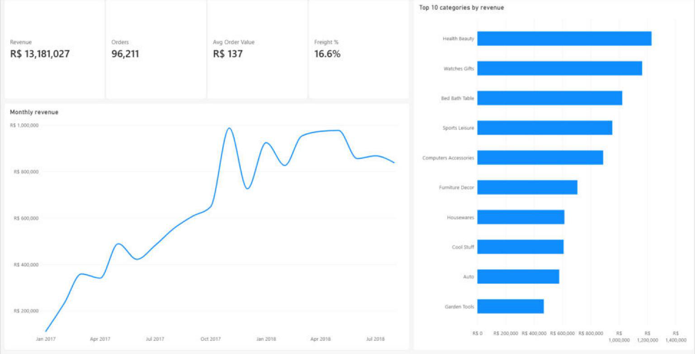
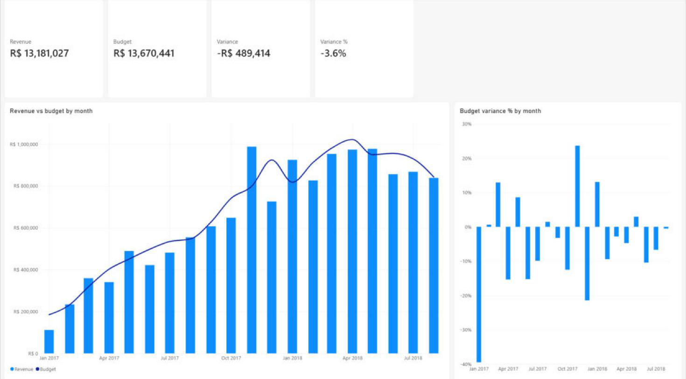
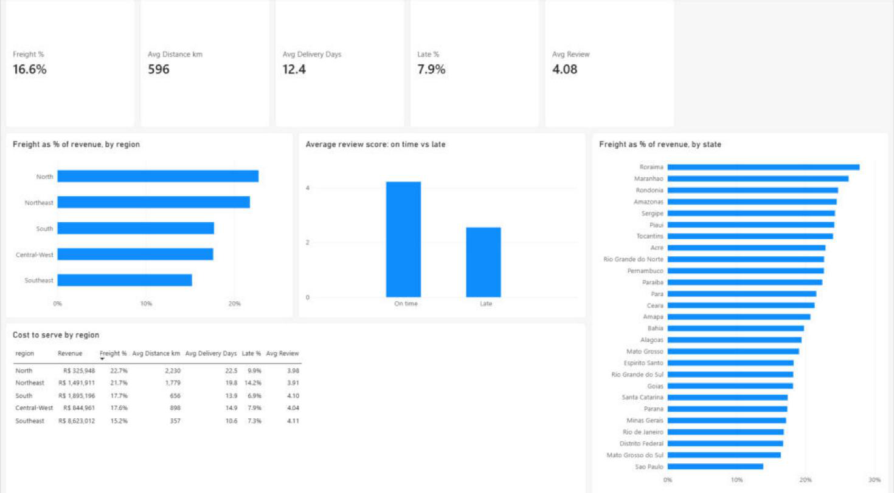

# Retail Sales & Cost-to-Serve Lakehouse

An end-to-end data pipeline and Power BI report on ~100,000 real e-commerce orders. Raw CSV exports go in at one end and a tested star schema comes out the other, with a report on top that answers three business questions:

| Question | Answer from the data (Jan 2017 – Aug 2018, delivered orders) |
|---|---|
| **How much are we selling?** | R$ 13.18M revenue, 96,211 orders, R$ 137 average order value |
| **Are we on budget?** | 96% of budget overall. Black Friday (Nov 2017) beat plan by 24%; the launch month missed by ~40% |
| **Where is fulfilment too expensive?** | Freight is **22.7%** of revenue in the North and **21.7%** in the Northeast vs **15.2%** in the Southeast. Those orders travel ~5× further, take twice as long, and late deliveries average **2.55★** vs **4.21★** on time |

**Recommendation the report supports:** sellers are concentrated around São Paulo. A fulfilment hub or local seller recruitment in the Northeast would cut freight cost, delivery time and late deliveries for the regions that rate the service lowest.



---

## Architecture

Medallion architecture on PySpark + Delta Lake, the same engine and table format as a Microsoft Fabric Lakehouse.

```
 9 Olist CSVs ─┐
               ▼
 BRONZE   raw, every column as string, + _ingested_at / _source_file      row counts reconciled to source
               ▼
 SILVER   typed, de-duplicated, conformed (cities, categories, geo)        35 data-quality checks
               ▼
 GOLD     star schema                                                     11 checks, revenue reconciled to Silver
          fact_order_item ── dim_date, dim_customer, dim_seller,
                             dim_product, dim_state
          fact_budget ────── dim_date, dim_state
               ▼
 POWER BI semantic model (7 relationships, 14 DAX measures) → 4 report pages
```

| Layer | What it does | Why |
|---|---|---|
| **Bronze** | Lands each source file unchanged as a Delta table, with ingestion time and source file | A replayable copy of the source; nothing silently converted; lineage for every row |
| **Silver** | Casts types, de-duplicates on keys, normalises messy text, applies business rules, runs data-quality checks | One clean, trustworthy version of each entity |
| **Gold** | Star schema at explicit grains (order item; month × state) | Fast, simple reporting; dimensions shared by sales and budget |

## Data quality

46 checks run on every pipeline run and are logged to a Delta table (`dq_results`), which also feeds the report's Data Quality page.

- **error** checks stop the pipeline: unique and non-null keys, referential integrity (every order item has an order, product and seller), price > 0, delivered ≥ purchased, Gold revenue = Silver revenue to the cent, every fact key exists in its dimension.
- **warn** checks record known, handled issues: 383 zero-freight items (free shipping, kept), 610 products without a category (labelled `unknown`), 42 geolocation points outside Brazil (dropped), 814 review ids shared across orders, and so on.

Issues found by profiling the raw data, and how they were handled:

| Found | Handled |
|---|---|
| Seller cities typed a dozen ways: `sp / sp`, `auriflama/sp`, `rio de janeiro, rio de janeiro, brasil`, a zip code in the city field | One normaliser (lower-case, strip accents, drop state/country suffixes, expand abbreviations), covered by 16 tests on real values |
| Geolocation: 1,000,163 rows for 19,015 zip prefixes | One row per prefix (median coordinates); joining the raw table would have multiplied revenue |
| Review comments with line breaks: 104,719 text lines but 99,224 records | Multi-line CSV parsing; counts reconciled with a CSV parser, not a line count |
| Partial months at both ends of the dataset | Trends and budget use the 20 full months only |

## Power BI report

| Page | Contents |
|---|---|
| Sales Overview | Revenue, orders, AOV, freight %; monthly revenue trend; top 10 categories (Top N filter) |
| Budget vs Actual | Revenue vs budget by month (combo chart); monthly variance % |
| Cost to Serve | Freight %, distance, delivery days, late %, review score by region and state; review score late vs on time |
| Data Quality | Every check from the latest pipeline run |




The report is saved as a Power BI Project (`powerbi/retail_cost_to_serve.pbip`), so the model (TMDL) and report (PBIR) are plain text under version control. Measures are in [`powerbi/measures.dax`](powerbi/measures.dax).

## Design decisions

- **Revenue = item price of delivered orders.** Cancelled, unavailable and in-transit orders are kept in the data but excluded from revenue; freight is treated as a cost-to-serve driver, not revenue.
- **A shared `dim_state`.** Sales are recorded per customer and budget per state; both facts join the same state dimension so one slicer filters both.
- **`delivery_status` as text, not only a boolean.** DAX treats BLANK as equal to FALSE, so a boolean late flag could not cleanly exclude undelivered orders in a report filter. The label is derived upstream in Gold instead of patched in the report.
- **Budget method.** A straight trend line gave a -60% variance in the launch month, because the business ramps up and then plateaus. The budget is a 3-month smoothed run-rate × 1.05, which behaves like a real plan.

## How to run

Requirements: Docker Desktop, the [Olist dataset](https://www.kaggle.com/datasets/olistbr/brazilian-ecommerce) unzipped into `data_set/archive/`, and Power BI Desktop for the report.

```bash
docker compose build
docker compose run --rm spark python -m src.run_pipeline     # Bronze -> Silver -> Gold -> Parquet export, ~4 min
docker compose run --rm spark python -m tests.test_cleaning    # city normaliser tests
```

Then open `powerbi/retail_cost_to_serve.pbip` and refresh. The report reads `lakehouse/export/*.parquet`; update the file path in each table's query if the repository lives elsewhere.

Optional Excel audit pack (recomputes the summary figures with formulas from the raw fact rows):

```bash
docker compose run --rm spark python -m scripts.export_review_extracts
python scripts/build_review_workbook.py
```

## Repository layout

```
src/            pipeline: config, bronze, cleaning, dq, silver, gold, export, run_pipeline
tests/          city normaliser tests
scripts/        smoke test, review workbook, report page generator
powerbi/        Power BI project (.pbip), DAX measures, TMDL scripts
docs/           plan, handoff log, screenshots
```

## Notes

- **Data:** [Brazilian E-Commerce Public Dataset by Olist](https://www.kaggle.com/datasets/olistbr/brazilian-ecommerce), real anonymised orders, 2016–2018. Amounts are in Brazilian reais (R$).
- **The budget is synthetic.** Olist publishes no budget; `fact_budget` is generated as described above and flagged `is_synthetic = true`.
- **How it was built:** I designed the pipeline, data-quality rules, model and report and reviewed every step; AI coding assistants (Claude Code) wrote much of the code under that direction. The Sales Overview page and the Power BI model relationships were built by hand in Power BI Desktop.
